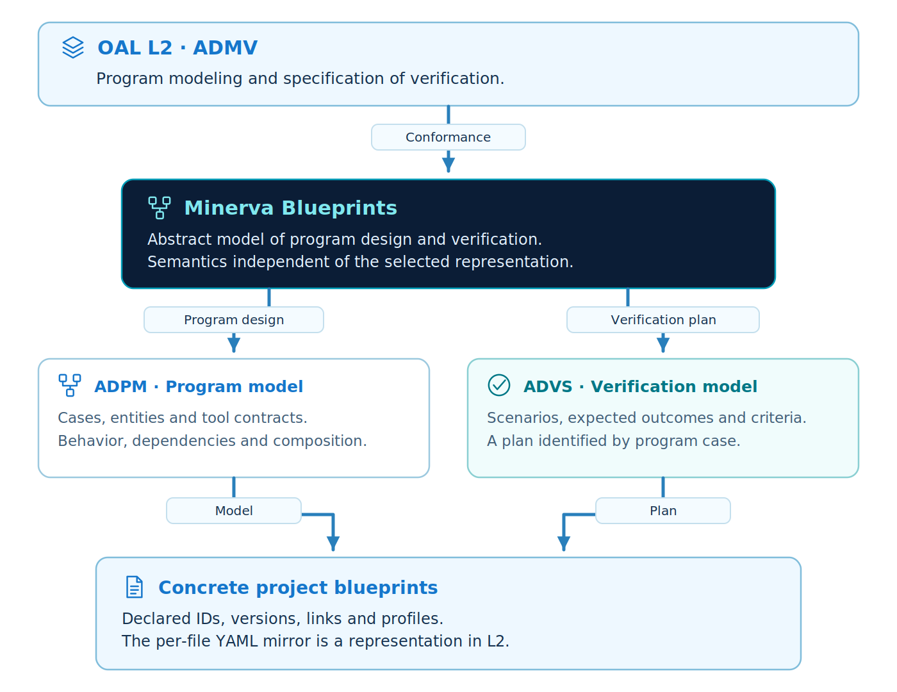
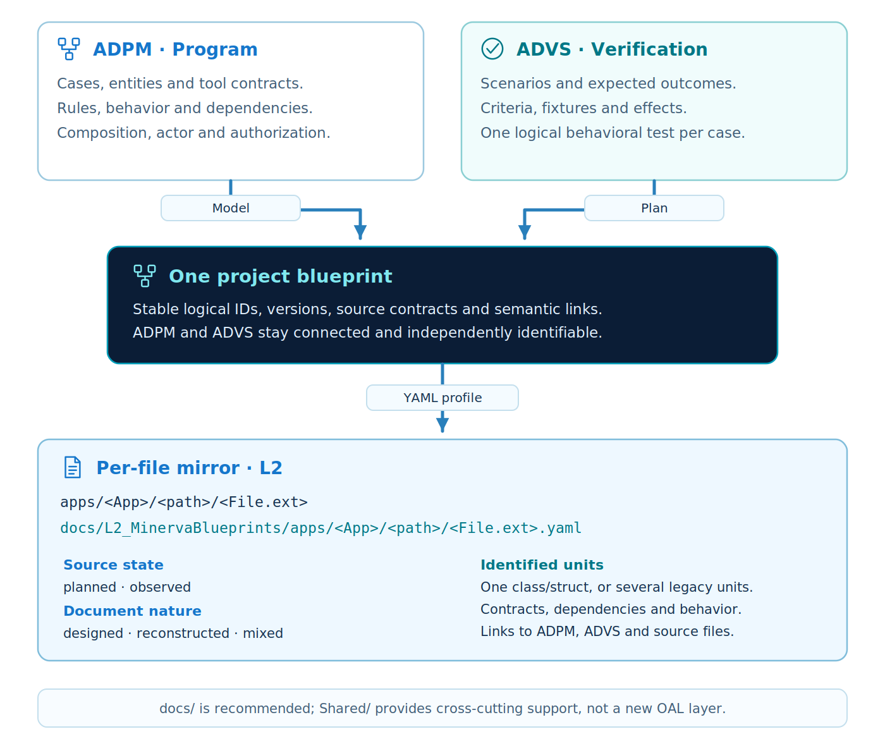
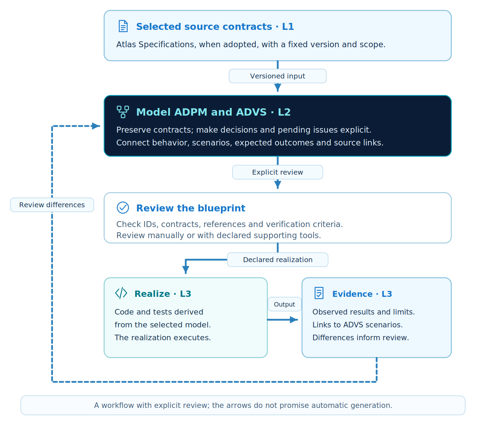

<p align="center"></p>

<p align="center"><strong>Minerva Blueprints Alpha-v0.1.0 · OAL L2 / ADMV</strong></p>

English · [Português brasileiro](README.pt-br.md)

# Minerva Blueprints

**Minerva Blueprints is an OAL L2 model for program modeling and verification specification.** It brings together ADPM and ADVS, case/entity/tool contracts, dependencies, behavior, scenarios and an L2 YAML mirror for source files.

Part of **Olympus Project**, alongside Atlas Specifications (L1) and Vulcan Ecosystem (L3).

This README is the illustrated introduction. The [edition manual](versioning/Alpha-v0.1.0/README.md) contains the textual rules. English is normative; Portuguese is its translation. The Alpha is supplied for experimentation and review; the [verification report](versioning/Alpha-v0.1.0/verification/RELEASE.md) delimits observed results.

## Contents

- [Position in Olympus](#position)
- [Program and verification](#content)
- [Workflow](#workflow)
- [Quick start](#quick-start)
- [Documentation by layer](#documentation)
- [Examples](#examples)
- [Versions](#versions)
- [Repository organization](#repository-organization)
- [Verification and integrity](#verification)
- [Authorship and license](#authorship)

<a id="position"></a>
## Position in Olympus

<p align="center"></p>

The reference is [OAL Stable-v1.0.0](https://github.com/CodeVaultCommunity/OAL_OpenAnalysisLayers). Atlas supplies L1 specifications; Minerva combines ADPM and ADVS at L2; Vulcan organizes realization at L3. Sources are pinned by revision and bytes in [source-baselines.json](versioning/Alpha-v0.1.0/verification/source-baselines.json).

<a id="content"></a>
## Program and verification

<p align="center"></p>

The model defines identities, contracts and relationships. The YAML profile represents that content and organizes per-file records. The validator checks structure, references, declared coverage and profile conditions; behavioral preservation remains an explicit review responsibility.

Read the [identified rules](versioning/Alpha-v0.1.0/README.md#reference-rules) and [requirements mapping](versioning/Alpha-v0.1.0/verification/REQUIREMENTS.md). Model identity, profile version and a document revision remain distinct.

<a id="workflow"></a>
## Workflow

<p align="center"></p>

Select the L1 source, model the program and scenarios, record decisions and validate the package. Records may describe planned files. When binding existing code, preserve the distinction between designed and observed content and record discrepancies.

<a id="quick-start"></a>
## Quick start

Use Python 3.11 or later. From the extracted repository root, run:

```bash
cd versioning/Alpha-v0.1.0
python -m venv .venv
# POSIX: source .venv/bin/activate
# PowerShell: .venv\Scripts\Activate.ps1
python -m pip install -r requirements.txt
python run_examples.py --all
python validator/minerva_validate.py examples/task-board-ecosystem/docs/L2_MinervaBlueprints/blueprint.yaml --root examples/task-board-ecosystem --json
```

The edition contains its own tools and resources. See the [manual](versioning/Alpha-v0.1.0/README.md#quick-start) for complete commands and prerequisites. The project distributes a model and reference tooling; a convenience library remains optional.

<a id="documentation"></a>
## Documentation by layer

| Recommended location | Content |
| --- | --- |
| `docs/L1_AtlasSpecifications/` | Originating cases and contracts. |
| `docs/L2_MinervaBlueprints/` | ADPM, ADVS and per-file YAML mirror. |
| `docs/L3_Vulcan/` | Organization, composition, operation, integrations and evidence. |
| `docs/Shared/` | Supporting and cross-layer material with canonical references. |

A root docs/ folder is recommended. A declared alternative may preserve the required information and links. Per-file records belong to Minerva: apps/TaskBoard/entities/Entity_Task.py maps to docs/L2_MinervaBlueprints/apps/TaskBoard/entities/Entity_Task.py.yaml. The specification repository retains its own editorial organization.

<a id="examples"></a>
## Examples

| Example | What it demonstrates |
| --- | --- |
| [TaskBoard](versioning/Alpha-v0.1.0/examples/task-board-ecosystem/README.md) | A dedicated Atlas source, ADPM, ADVS and L2 records. |
| [Minimal](versioning/Alpha-v0.1.0/examples/minimal/README.md) | A small contract to start from. |
| [Legacy](versioning/Alpha-v0.1.0/examples/legacy/README.md) | Multiple units in one legacy file. |
| [Planned](versioning/Alpha-v0.1.0/examples/planned/README.md) | Modeling before implementation. |

TaskBoard uses its own reconstructed didactic Atlas instance. Its contract differs from the Task Board published by Atlas. Origin, differences and limits are identified in the example documents; automatic generation and independent stakeholder approval are not claimed.

<a id="versions"></a>
## Versions

| Edition | Status | Manual and notes | Verification |
| --- | --- | --- | --- |
| Alpha-v0.1.0 | Alpha | [English](versioning/Alpha-v0.1.0/README.md#release-notes) · [Português](versioning/Alpha-v0.1.0/README.pt-br.md#release-notes) | [Report](versioning/Alpha-v0.1.0/verification/RELEASE.md) |

Each edition contains its dependencies, tools, examples and tests. This distribution contains only Alpha-v0.1.0; future revisions must preserve published snapshots and declare migrations.

<a id="repository-organization"></a>
## Repository organization

| Location | Purpose |
| --- | --- |
| `README.md`, `README.pt-br.md` | Illustrated introduction and navigation. |
| [`assets/`](assets/README.md) | Supplied icons, headers, diagrams and editable sources. |
| [`versioning/Alpha-v0.1.0/`](versioning/Alpha-v0.1.0/README.md) | Textual manual and self-contained edition. |
| [`CONTENT-SHA256.json`](CONTENT-SHA256.json) | Single byte-size and hash inventory for distribution. |
| [`scripts/`](scripts/) | Links, inventory and packaging checks. |
| [`docs/releasing.md`](docs/releasing.md) | Reproducible distribution procedure. |
| [`AGENTS.md`](AGENTS.md), [`CLAUDE.md`](CLAUDE.md) | Agent navigation and maintenance. |

<a id="verification"></a>
## Verification and integrity

```bash
python scripts/check_archive.py .
python scripts/check_repository.py
```

Run the directory audit immediately after extraction, before creating environments or caches inside it. The inventory covers every distributed file except itself, detecting missing, additional and changed files. The [release guide](docs/releasing.md) distinguishes local checks, configured CI and remote publication.

<a id="authorship"></a>
## Authorship and license

Project concept and authorship: **Douglas de Oliveira Alkimim**. This Alpha was prepared with AI assistance for review. Distributed under the [MIT license](LICENSE). Source and asset credits are in [ACKNOWLEDGEMENTS.md](ACKNOWLEDGEMENTS.md); citation metadata is in [CITATION.cff](CITATION.cff).

<p><strong>Douglas de Oliveira Alkimim</strong><br><a href="https://github.com/douglas-alkimim">GitHub</a> · <a href="https://www.linkedin.com/in/douglas-alkimim/">LinkedIn</a></p>
<br clear="all">
