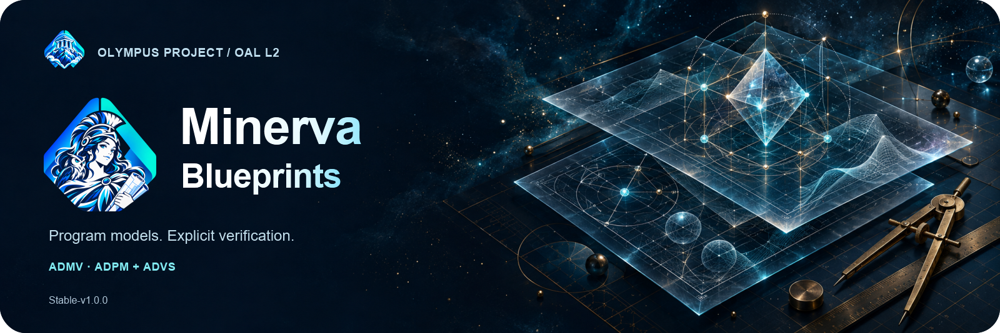

<p align="center"></p>

# Minerva Blueprints

[Português brasileiro](README.pt-br.md) · [Stable-v1.0.0](versioning/Stable-v1.0.0/README.md) · [Verification](versioning/Stable-v1.0.0/verification/RELEASE.md)

Minerva is the OAL L2 layer between Atlas Specifications and Vulcan code. The
Stable-v1.0.0 contract replaces the former central YAML blueprint with a
distributed tree of strict Markdown modules shaped like the future codebase.

Each module preserves its complete Atlas semantics in `atlas-source-json` and
adds generation-oriented technical design in `minerva-design-json`: targets,
symbols, methods, collaborators, algorithms, failures, effects, tests, and
graph links. Reading all listed modules reconstructs all of Atlas plus L2
design; `minerva.project.yaml` is discovery only.

Abstract tools remain protocols. Concrete tools are detailed Markdown designs
with technology, lifecycle, configuration, transactions, and error mappings —
not executable L2 code. `Boundary` is reserved for interaction adapters;
behavioral scenarios use `observation_points`.

```powershell
cd versioning/Stable-v1.0.0
python -m pip install -e .
python run_examples.py
python -m unittest discover -s tests -v
```

The maintained minimal, composition, and task-board examples preserve 477
Atlas concepts in 76 Markdown modules and declare 31 downstream generation
targets. Their knowledge graphs index Atlas concepts, technical modules,
relationships, and abstract-to-concrete tool lineage.

The earlier [Alpha-v0.1.0](versioning/Alpha-v0.1.0/README.md) remains available
as a historical edition. Concept and authorship: Douglas de Oliveira Alkimim.
[MIT license](LICENSE).
