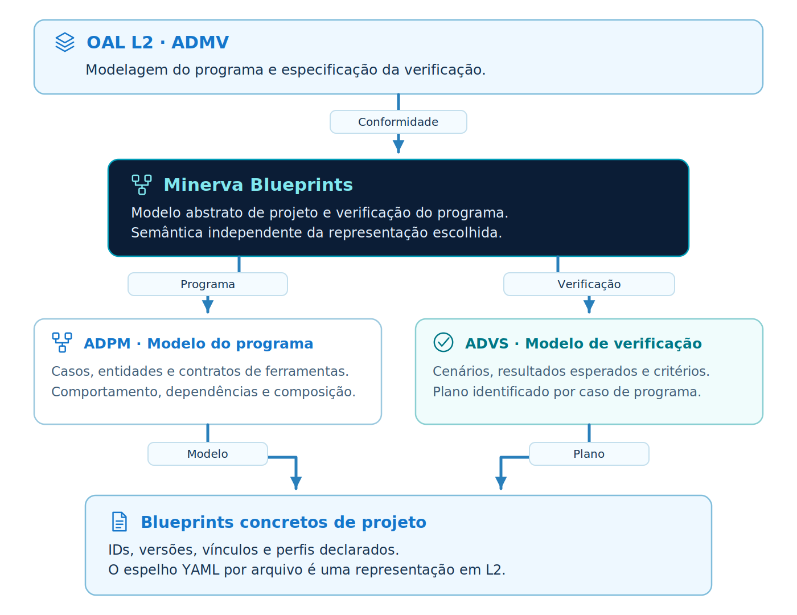
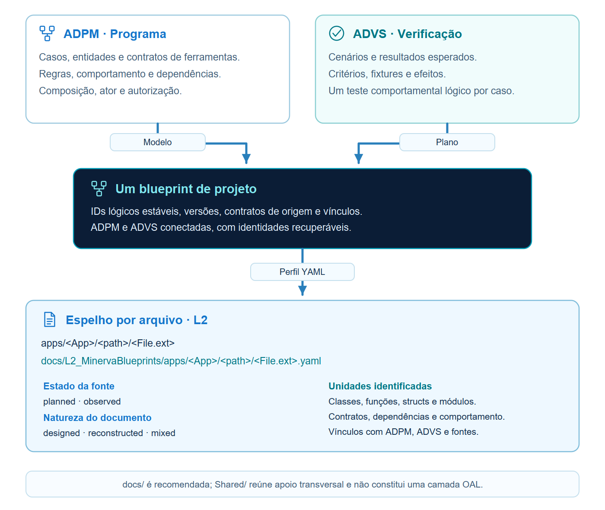
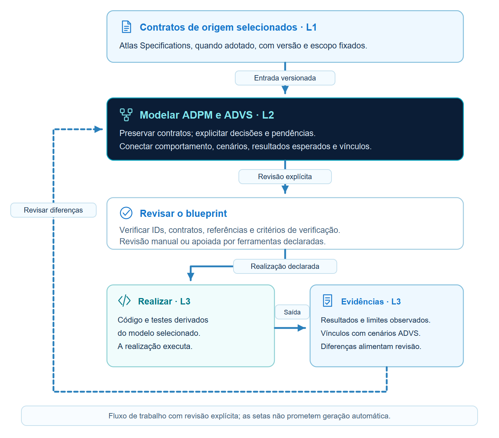

<p align="center"></p>

# Minerva Blueprints

[English](README.md)

**Modelo OAL L2 / ADMV para modelagem de programa e especificação de verificação.** ADPM e ADVS permanecem conectadas, com contratos, regras, dependências, cenários e rastreabilidade.

Esta Alpha ainda não foi publicada e foi revisada no próprio diretório por autorização do responsável. Inclui perfil YAML e validador de referência. **Não inclui reader do Atlas nem motor de tradução.** Os exemplos são elaborações L2 dos mesmos exemplos oficiais do Atlas; um futuro motor será um projeto separado.

[Comece aqui](docs/getting-started.pt-br.md) · [Alpha-v0.1.0](versioning/Alpha-v0.1.0/README.pt-br.md) · [Modelo normativo](versioning/Alpha-v0.1.0/specification/model.pt-br.md)

## Posição no Olympus



Atlas fornece L1 quando adotado; Minerva estabelece L2; Vulcan pode organizar a realização L3. Escolhas de interação pertencem a L4. A pasta recomendada para uma aplicação é `docs/`, com materiais dos modelos adotados em `L1_AtlasSpecifications`, `L2_MinervaBlueprints`, `L3_Vulcan` e `Shared`.



## Exemplos e integração

- [Cadastro mínimo de solicitações](versioning/Alpha-v0.1.0/examples/minimal/README.pt-br.md)
- [TaskBoard](versioning/Alpha-v0.1.0/examples/task-board/README.pt-br.md), [revisões 2 / 3](versioning/Alpha-v0.1.0/examples/task-board/revisions/README.pt-br.md)
- [Composição de reservas](versioning/Alpha-v0.1.0/examples/composition/README.pt-br.md)
- [Mapeamento Atlas](versioning/Alpha-v0.1.0/integrations/atlas/mapping.pt-br.md)

Os contratos, IDs e critérios de origem são preservados; código de aplicação e execuções de domínio não são fornecidos. A validação verifica declarações Minerva e integridade da fonte. A revisão semântica é separada.

## Uso e organização

```bash
cd versioning/Alpha-v0.1.0
python -m pip install .
python run_examples.py --all
```

Use Python 3.11+ em ambiente fora da árvore de entrega. `specification/` contém regras; `implementations/`, o perfil; `integrations/`, mapeamentos; `minerva_blueprints/`, a ferramenta; `examples/` e `tests/`, demonstrações e verificações; `verification/`, fontes, revisão e evidências. Cada edição é autossuficiente.



[Verificação](versioning/Alpha-v0.1.0/verification/VALIDATION.pt-br.md) · [Procedimento de distribuição](docs/releasing.pt-br.md) · [Ilustrações](assets/README.pt-br.md) · [Agradecimentos](ACKNOWLEDGEMENTS.md)

Após extrair uma distribuição, execute `python scripts/check_archive.py .` antes de criar caches dentro dela. Em checkout Git, use `python scripts/content_inventory.py --check`.

Douglas de Oliveira Alkimim · Olympus Project · [MIT](LICENSE)
